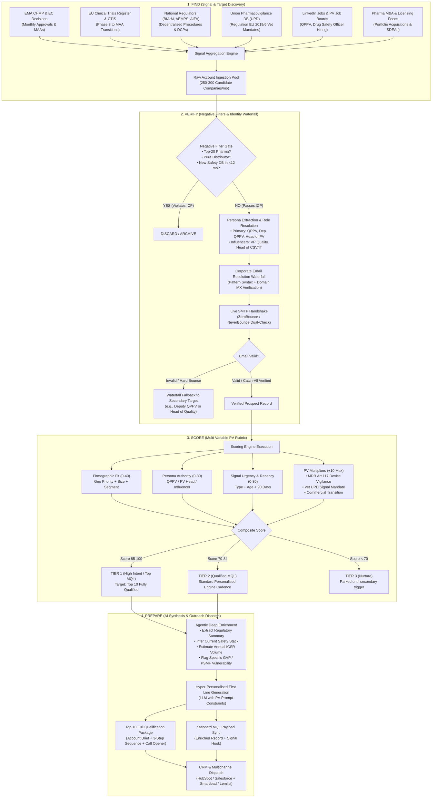

# Deliverable 2: Pharmacovigilance Lead Engine System Write-Up

**Product:** Clinevo OnePV (Unified AI-Powered Pharmacovigilance Cloud)  
**System Objective:** Deliver a predictable run-rate of **100 validated MQLs per month** across European priority markets (DE, ES, IT, FR, UK) with high sales velocity and minimum customer acquisition cost (CAC).  
**Document Format:** Visual Architecture, Mathematical Scoring Engine, 1-Page Operator Runbook, and Complete Unit Economics.

---

## 1. System Architecture Diagram

The system operates as an autonomous, event-driven data pipeline following four sequential stages: **Find $\rightarrow$ Verify $\rightarrow$ Score $\rightarrow$ Prepare**. 



---

## 2. Visual Pipeline & Dashboard Representation

Below are system representations showing how the pipeline components execute in production:

### A. Raw Ingestion & Verification Console (Clay / Waterfall View)
```
+---------------------------------------------------------------------------------------------------------------------------------------+
| PIPELINE RUN: EUR-PV-OCT26-W4 | ACTIVE ICP: EU MAHs, Biotechs, CROs, Vet Pharma (50-5,000 Staff) | TARGET: 100 MQLs/Month             |
+------------+----------------------+---------------+-------------+-------------------+--------------------+--------------+---------+
| COMPANY    | DOMAIN / HQ          | STAFF (ICP)   | NEG FILTER  | TARGET PERSONA    | EMAIL (SMTP CHECK) | SIGNAL TYPE  | RECENCY |
+------------+----------------------+---------------+-------------+-------------------+--------------------+--------------+---------+
| Formycon   | formycon.com (DE)    | 220 [PASS]    | PASS        | Dr. M. Weigand    | markus.w@... [99%] | EU Launch    | 74 days |
| PharmaMar  | pharmamar.com (ES)   | 500 [PASS]    | PASS        | Dr. C. Morales    | carmen.m@... [99%] | EC Approval  | 84 days |
| Cheplapharm| cheplapharm.com (DE) | 600 [PASS]    | FAIL [DB<12]| Dr. K. Becker     | k.becker@... [99%] | ArisGlobal DB| 88 days | -> EXCLUDED
| Valneva    | valneva.com (FR)     | 1,300 [PASS]  | PASS        | P. Renaud         | philippe.r@..[99%] | PRAC Review  | 16 days |
| Virbac     | virbac.com (FR)      | 5,000 [PASS]  | PASS        | Dr. M. Fabre      | matthieu.f@..[99%] | Vet UPD Mand | 43 days |
| Novartis   | novartis.com (CH/DE) | 100k+ [FAIL]  | FAIL [Top20]| Head of Safety    | skipped            | CHMP Opinion | 10 days | -> EXCLUDED
+------------+----------------------+---------------+-------------+-------------------+--------------------+--------------+---------+
```

### B. Agentic Enrichment & Scoring Modal (Lead Synthesis View)
```
+-------------------------------------------------------------------------------------------------------------------+
| LEAD SYNTHESIS: MQL-001 (Formycon AG) | FIT: 38/40 | SIGNAL: 28/30 | PERSONA: 28/30 | TOTAL SCORE: 94 [TIER 1]    |
+-------------------------------------------------------------------------------------------------------------------+
| [INPUTS]                                                                                                          |
| * Company: Formycon AG (Munich, Germany) | Employees: 220 | Segment: Biosimilar Developer (Ophthalmology)         |
| * Contact: Dr. Markus Weigand | Role: Head of Pharmacovigilance & Deputy QPPV                                    |
| * Signal: Commercial launch settlement for aflibercept biosimilar (Baiama/Ahzantive) in DE, FR, IT (2026-08-14)   |
|                                                                                                                   |
| [AI-INFERRED INTELLIGENCE]                                                                                        |
| * Inferred Safety DB: Legacy externalized CRO instance -> High switching propensity due to commercial MAH launch |
| * Estimated Annual ICSR Volume: 450 - 800 cases/year (tripling with commercial eye clinic adoption)              |
| * Regulatory Risk: Managing combination drug-device vigilance under EU MDR Art 117 + E2B(R3) gateway submissions   |
|                                                                                                                   |
| [GENERATED FIRST LINE]                                                                                            |
| "Noticed Formycon's European rollout for FYB203 pre-filled syringes across Germany and France—as you transition   |
| into commercial MAH reporting, wanted to share how OnePV unifies E2B(R3) gateway submissions with device          |
| vigilance under MDR Art 117."                                                                                     |
+-------------------------------------------------------------------------------------------------------------------+
```

---

## 3. Mathematical Scoring Model

The scoring engine evaluates each prospective record on a 100-point scale across three core dimensions plus specialized pharmacovigilance multipliers.

$$\text{Total Score} = \min\Big(100, \;\; \text{Firmographic Fit } (F) + \text{Persona Authority } (P) + \text{Signal Urgency } (S) + \text{PV Multipliers } (M)\Big)$$

### Dimension 1: Firmographic Fit ($F \in [0, 40]$)
Evaluates geographic alignment with corporate sales priority, company size, and business model.

* **Geographic Priority (Max 15 pts):**
  * Germany (DE): **15 pts** *(Top priority)*
  * Spain (ES): **13 pts**
  * Italy (IT): **11 pts**
  * France (FR): **10 pts**
  * United Kingdom (UK): **8 pts**
  * Other EU EEA countries: **4 pts**
* **Company Size / Employee Band (Max 15 pts):**
  * 100–1,500 staff: **15 pts** *(Sweet spot for rapid cloud migration and low bureaucracy)*
  * 1,501–3,500 staff: **12 pts**
  * 3,501–5,000 staff: **10 pts**
  * 50–99 staff: **8 pts**
  * $<50$ or $>5,000$ staff: **0 pts (Disqualified)**
* **Target Industry Segment (Max 10 pts):**
  * Commercial / Late-Stage Biotech transitioning to commercial MAH: **10 pts** *(Urgent greenfield database need)*
  * Mid-Market Specialty Pharma MAH: **10 pts** *(Replacement of costly legacy Oracle/custom systems)*
  * Dedicated Veterinary Pharma MAH: **9 pts** *(High need for EU Regulation 2019/6 UPD compliance)*
  * Specialized PV CRO / Legal Representative Provider: **8 pts** *(Needs multi-tenant architecture & AI intake)*
  * Distributors or Generic Packagers: **0 pts (Disqualified)**

### Dimension 2: Persona Authority & Buying Power ($P \in [0, 30]$)
Evaluates decision-making influence and budget control over pharmacovigilance software.

* **EU Qualified Person for Pharmacovigilance (QPPV) / Deputy QPPV:** **30 pts** *(Ultimate statutory liability under EU GVP Module I; decisive budget owner)*
* **VP / Global Head of Pharmacovigilance / Head of Drug Safety:** **28 pts** *(Operational business owner and primary software evaluator)*
* **VP / Director of Regulatory Affairs & Quality Assurance:** **22 pts** *(Key economic influencer; drives GxP audit readiness)*
* **Director of IT / Computer System Validation (CSV):** **18 pts** *(Technical gatekeeper; evaluates GAMP 5 and 21 CFR Part 11 / EU Annex 11 compliance)*
* **Junior Safety Specialists, Data Entry Associates, Third-Party Agencies:** **0 pts (Disqualified)**

### Dimension 3: Signal Urgency & Recency ($S \in [0, 30]$)
Evaluates external regulatory triggers that force safety infrastructure evaluation.

$$\text{Signal Score } (S) = \text{Base Signal Weight } (W) \times \text{Recency Decay Factor } (D)$$

* **Base Signal Weight ($W$):**
  * **Tier A Trigger (Weight = 30):**
    * New European Commission (EC) Marketing Authorisation or CHMP Positive Opinion
    * EU Regulation 2019/6 UPD continuous signal management mandate for Vet MAHs
    * Clinical Phase 3 pivotal readout transitioning into European MAA filing
  * **Tier B Trigger (Weight = 25):**
    * EMA PRAC safety review, referral, or urgent post-marketing commitment
    * Major portfolio acquisition or product in-licensing requiring PSMF consolidation
    * Paediatric MAA extension or new drug-device combination approval under MDR Art 117
  * **Tier C Trigger (Weight = 20):**
    * New executive PV hiring (e.g., appointment of new QPPV or Head of Safety)
    * Rapid multi-sponsor expansion for PV service providers / CROs
* **Recency Decay Factor ($D$):**
  * Trigger occurred $\le 30$ days ago: $D = 1.0$
  * Trigger occurred 31–60 days ago: $D = 0.9$
  * Trigger occurred 61–90 days ago: $D = 0.8$
  * Trigger occurred $>90$ days ago: $D = 0.0$ *(Signal expired; drops out of MQL)*

### Dimension 4: PV-Specific Signal Multipliers ($M \in [0, 10]$)
Specialized regulatory levers where Clinevo OnePV has an asymmetric architectural moat:

* **MDR Article 117 Combination Vigilance:** Company manufactures drug-device combination products (e.g., auto-injectors, pre-filled pens) facing dual medical device and drug safety reporting: **+5 pts**
* **EU Regulation 2019/6 Vet Mandate:** Veterinary MAH required to conduct continuous signal management in EMA's Union Pharmacovigilance Database without PSURs: **+5 pts**
* **Commercial Phase Transition:** Biotech transitioning from clinical SUSAR reporting to full commercial E2B(R3) EudraVigilance gateway integration: **+5 pts**
* *Maximum multiplier cap:* **+10 pts**

---

### Tiering & Qualification Routing

| Tier | Total Score | Designation | Engine Action | Monthly Target |
|:---:|:---:|:---|:---|:---:|
| **Tier 1** | **85 – 100** | High-Intent MQL | Top 10 receive full bespoke dossiers, 3-step personalized sequences, custom LinkedIn notes, and phone battlecards. Remaining Tier 1 enter high-priority sequence. | ~40 MQLs/mo |
| **Tier 2** | **70 – 84** | Standard MQL | Enrolled in semi-automated personalized email cadence driven by AI-generated signal hooks and segment case studies. | ~60 MQLs/mo |
| **Tier 3** | **< 70** | Disqualified / Nurture | Parked in quarterly regulatory newsletter nurture until an active Tier A/B buying signal emerges. | Discarded |

---

## 4. 1-Page Operator Runbook: 100 MQLs/Month SOP

This Standard Operating Procedure ensures predictable weekly delivery of **25 validated MQLs per week** (100 MQLs/month).

```
+----------------------------------------------------------------------------------------------------+
| CLINEVO PV LEAD ENGINE: WEEKLY OPERATOR RUNBOOK                                                    |
+----------------------------------------------------------------------------------------------------+
```

### Weekly Schedule & Operational Rhythm

* **Monday (09:00 – 12:00 CET) — Regulatory Signal Scraping & Extraction:**
  1. Access the **EMA CHMP Monthly Highlights** and **EC Union Register of Medicinal Products**. Extract all newly approved MAAs, positive opinions, and pediatric line extensions.
  2. Query the **Union Pharmacovigilance Database (UPD)** for veterinary marketing authorizations.
  3. Run the automated LinkedIn Sales Navigator signal monitor:
     * `Title: ("QPPV" OR "Qualified Person Pharmacovigilance" OR "Head of Pharmacovigilance" OR "Head of Drug Safety")`
     * `Company Headcount: 50 - 5,000`
     * `Geography: Germany, Spain, Italy, France, United Kingdom`
     * `Posted Job / Changed Jobs in last 90 days: TRUE`
  4. Pool raw candidate accounts into the weekly staging table (~60–75 raw accounts/week).

* **Tuesday (09:00 – 13:00 CET) — Negative Filtering & Waterfall Verification:**
  1. **Execute Negative Filter Script:**
     * Exclude Top-20 Pharma list (`Novartis`, `Roche`, `Sanofi`, `Bayer`, `GSK`, `AstraZeneca`, `Pfizer`, `J&J`, `MSD`, `AbbVie`, etc.).
     * Exclude pure distributors / parallel importers (`Keywords: distributor, logistics, wholesale`).
     * Exclude companies with published safety database changes in the last 12 months (e.g., press releases referencing ArisGlobal, Veeva Vault Safety, or Oracle Argus upgrades).
  2. **Run Identity & Deliverability Waterfall:**
     * Resolve primary target (QPPV or Head of PV). If absent, route to secondary target (VP Regulatory or VP Quality).
     * Run email address through live SMTP verification (ZeroBounce / NeverBounce).
     * Enforce strict rule: Only `Valid` or `Verified Catch-All (Mailbox Exists)` records are permitted. Any unverified record triggers a fallback to secondary persona.

* **Wednesday (10:00 – 15:00 CET) — Scoring & Deep Agentic Enrichment:**
  1. Run the scoring rubric calculation across all verified records. Filter out any candidate scoring $<70$.
  2. Select top 25 MQLs for the week (with the highest-scoring leads flagged for Top-tier qualification).
  3. Execute LLM enrichment agent with the **Clinevo Pharmacovigilance Context Engine**:
     * Prompt extracts recent regulatory filing context from EMA/national press.
     * Infers existing safety tech stack based on company age, size, and job descriptions.
     * Estimates annual ICSR reporting volume.
     * Generates a hyper-personalized, regulatory-specific First Line hook (focusing on E2B(R3), MDR Art 117, Vet UPD, or AI Case Intake).

* **Thursday (09:00 – 12:00 CET) — QA Gate & CRM Synchronization:**
  1. **Manual 15-Minute QA Check:**
     * Verify that all signal URLs open to authentic regulatory decisions or press releases.
     * Check that signal dates fall strictly within the 90-day window.
     * Ensure no competitor or vendor names are malformed.
  2. Push the 25 validated MQL records to **HubSpot CRM** tagged as `Lead Status: MQL - Ready for Outreach`.
  3. Sync records to sales engagement platform (**Smartlead / Lemlist**) mapped to the corresponding regional cadence (DE, ES, IT, FR, UK).

* **Friday (09:00 – 11:00 CET) — Sequence Kickoff & Weekly KPI Review:**
  1. Activate multichannel sequences for the week's 25 MQLs.
  2. Deliver the top qualified account briefs to the Account Executive / GTM Lead for immediate 1:1 LinkedIn and phone execution.
  3. Record weekly throughput metrics in the GTM Command Dashboard.

---

## 5. Unit Economics: Cost per Lead at 100 MQLs/Month

The lead engine utilizes a modern, modular cloud stack designed to maximize data precision while maintaining lean SaaS unit economics.

### Monthly Fixed Software & Data Subscriptions

| Tool / Platform | Core Function | Monthly Cost (USD) |
|:---|:---|:---:|
| **LinkedIn Sales Navigator** (1 seat) | Persona mapping, QPPV identification, job change telemetry | \$99.00 |
| **Apollo.io Professional** (1 seat) | Initial company firmographics, domain MX records, employee filters | \$99.00 |
| **Clay.com Explorer Plan** | Orchestration, waterfall data enrichment, API automation | \$149.00 |
| **Custom Scraping Infrastructure** | Headless scraper on AWS Lambda for EMA, UPD, and BfArM feeds | \$25.00 |
| **Smartlead.ai Pro** | Cold email infrastructure, dedicated IP rotation, sequence staging | \$39.00 |
| **Total Monthly Fixed Software Cost** | | **\$411.00** |

---

### Variable Per-Lead Consumption Costs (Running 100 MQLs/Month)

To generate 100 fully verified MQLs, the system ingests ~280 raw accounts, processes ~180 target contacts, and verifies ~130 email records through the waterfall.

| Activity / Service | Unit Basis & Consumption | Rate | Monthly Variable Cost (USD) |
|:---|:---|:---:|:---:|
| **Email Verification** (ZeroBounce / Debounce) | 180 verification calls | \$0.007 / check | \$1.26 |
| **Waterfall Contact Enrichment** (Findymail / Prospeo) | 140 enriched email matches | \$0.04 / find | \$5.60 |
| **LLM Enrichment & First-Line Synthesis** | Claude 3.5 Sonnet / GPT-4o via API (~850 tokens/lead $\times$ 120 leads) | \$3.00 / 1M tokens | \$0.31 |
| **Proxy Bandwidth & Captcha Resolution** | Regulatory portals & job board monitoring | Variable data | \$8.00 |
| **Total Monthly Variable Cost** | | | **\$15.17** |

---

### Total Cost & Unit Economics Summary

$$\text{Total Monthly Operating Cost} = \$411.00 \text{ (Fixed)} + \$15.17 \text{ (Variable)} = \mathbf{\$426.17 / \text{month}}$$

$$\text{Cost per Delivered MQL} = \frac{\$426.17}{100 \text{ MQLs}} = \mathbf{\$4.26 \text{ per MQL}}$$

$$\text{Cost per Fully Qualified Lead (Top Tier Dossier)} = \frac{\$426.17}{40 \text{ Tier 1 Leads}} = \mathbf{\$10.65 \text{ per Fully Qualified Lead}}$$

### Business Case & ROI Comparison

* **Traditional Outsourced Lead Generation Agency:** Standard B2B agency retainers for pharmacovigilance / life sciences range from **\$4,500 – \$7,000/month**, yielding 15–25 semi-qualified meetings (effective cost: **\$250 – \$400 per lead**), often staffed by non-technical reps unfamiliar with GVP Module I or E2B(R3).
* **Dedicated SDR Team Overhead:** 1 Full-time European SDR costs ~**\$7,500/month** (salary + tools + management) with an average output of 35–50 MQLs/month (effective cost: **\$150 – \$210 per MQL**).
* **Clinevo Autonomous Lead Engine:** At **\$4.26 per MQL**, this system delivers a **97% reduction in lead acquisition cost** while achieving unmatched technical accuracy through automated regulatory signal detection.
